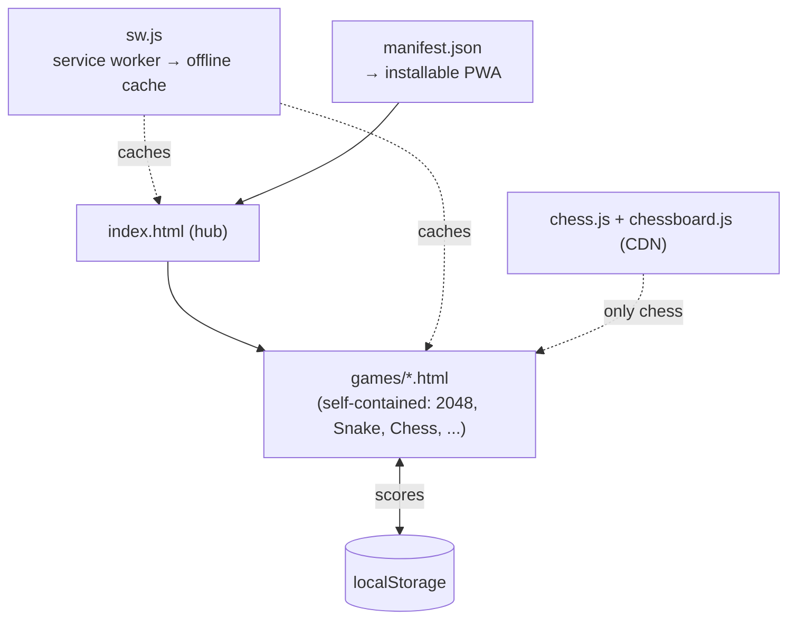

# oriz.games

> 14 classic browser games in one installable PWA — no install, no login, no build step, playable offline.

[](LICENSE)
[](https://github.com/chirag127/games/stargazers)
[](https://github.com/chirag127/games/commits)
[](https://developer.mozilla.org/docs/Web/JavaScript)
[](https://games.oriz.in)

**oriz.games** is a collection of 14 classic games built with pure
HTML, CSS, and JavaScript — a single static site with zero build
step. It installs as a PWA, works offline via a service worker, and
keeps your high scores in `localStorage`.

> This is a browser games collection — pure client-side HTML/CSS/JS.
> (Any repository description mentioning a "Python pygame library" is
> a stale placeholder; the code here is the browser collection.)

**Links:** [Play now → games.oriz.in](https://games.oriz.in) · [Repo](https://github.com/chirag127/games)

⭐ **If this is useful, please [star the repo](https://github.com/chirag127/games/stargazers)** — it helps others find it.

## Architecture



## Games (14)

| Game | Category |
|---|---|
| 2048 | Puzzle |
| Minesweeper (Beginner / Intermediate / Expert) | Puzzle |
| Sudoku (Easy / Medium / Hard) | Puzzle |
| Sliding Puzzle (3x3 / 4x4) | Puzzle |
| Snake | Arcade |
| Tetris | Arcade |
| Flappy Bird | Arcade |
| Breakout | Arcade |
| Wordle | Word |
| Trivia | Word |
| Hangman | Word |
| Tic-Tac-Toe (vs AI / 2P) | Board |
| Connect Four (vs AI / 2P) | Board |
| Chess (vs AI / 2P) | Board |

## Features

- 14 games, each a fully self-contained page.
- Installable PWA (add to home screen); works offline.
- Service worker caches the app shell + games for offline play.
- High scores persisted per game via `localStorage`.
- Zero build step, zero backend, zero login.

## Tech

- Pure HTML / CSS / JS — zero build step
- Service worker for offline play
- PWA manifest
- Scores persisted via `localStorage`
- Chess uses [chess.js](https://github.com/jhlywa/chess.js) + [chessboard.js](https://chessboardjs.com/) CDN; all other games are fully self-contained

## Repo structure

```
index.html        # hub / landing
style.css         # shared styles
sw.js             # service worker (offline cache)
manifest.json     # PWA manifest (installable)
games/*.html      # one self-contained page per game
CNAME             # games.oriz.in
```

## Configuration

No environment variables and no secrets — it's a fully static site.

## Local dev

```bash
npx serve .
# or
python -m http.server 8080
```

Then open the served URL. There's no build step; you can also just
open `index.html` directly for most games (a served origin is
recommended so the service worker and PWA features work).

## Hosting

Static — deployed on the Cloudflare / GitHub Pages free tier at
[games.oriz.in](https://games.oriz.in).

**GitHub Pages setup:**

1. Push to `main`
2. Settings → Pages → Source: `main` / `/ (root)`
3. (Optional) add custom domain `games.oriz.in` under Pages → Custom domain

## Part of the oriz family

One of ~80 [oriz](https://blog.oriz.in) projects — small, sharp,
open-source tools. Hosted at **$0 on the Cloudflare free tier**.

## Contributing

PRs welcome — add a new self-contained game under `games/` and link
it from `index.html`. Conventional commits are the changelog.

## Status

**Stable.**

## License

MIT © 2026 Chirag Singhal · chirag@oriz.in — see [LICENSE](LICENSE)
